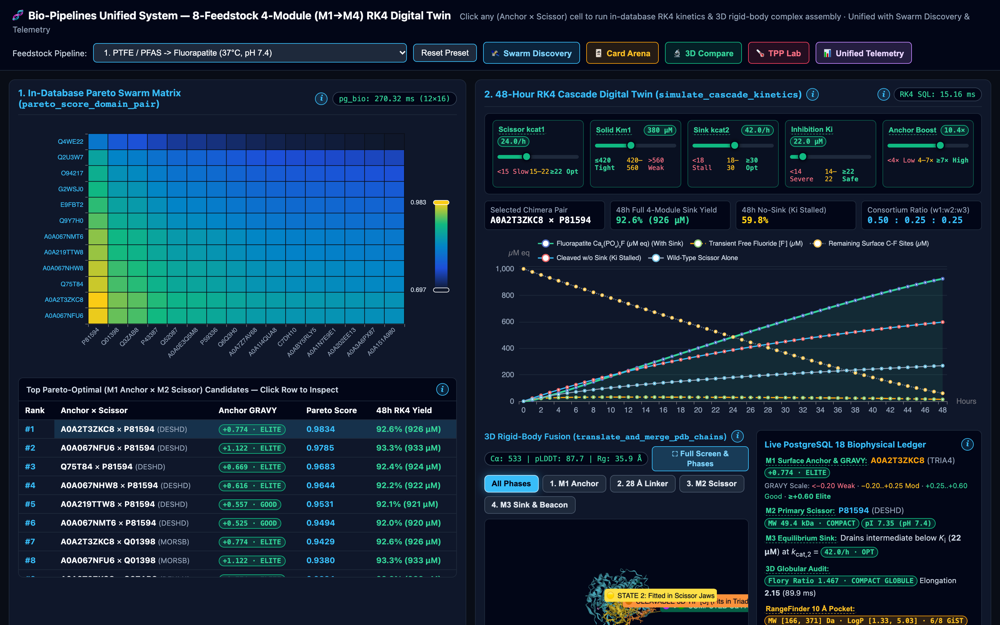
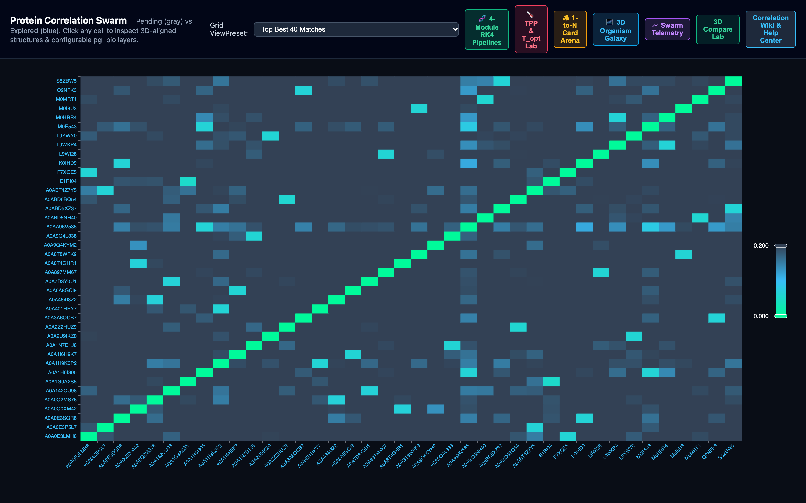
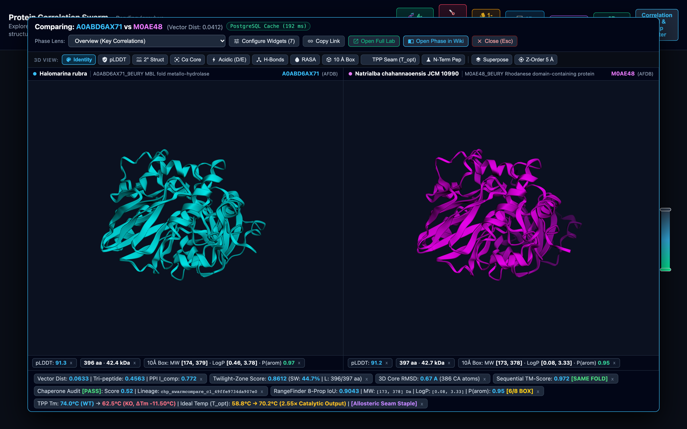
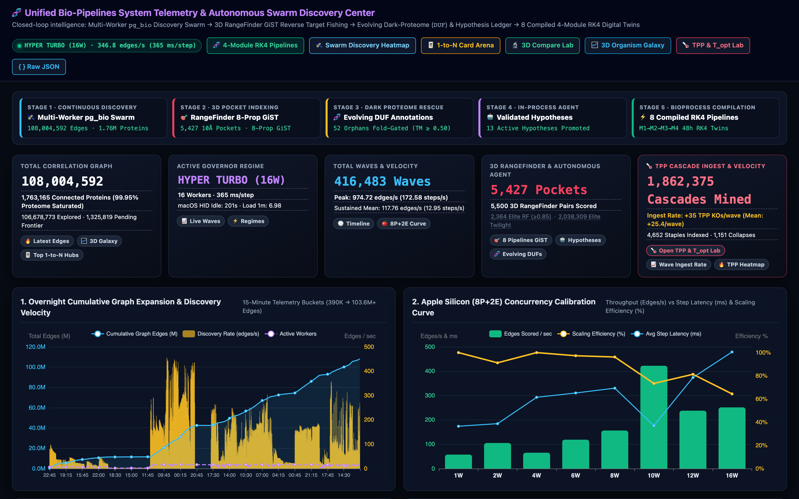
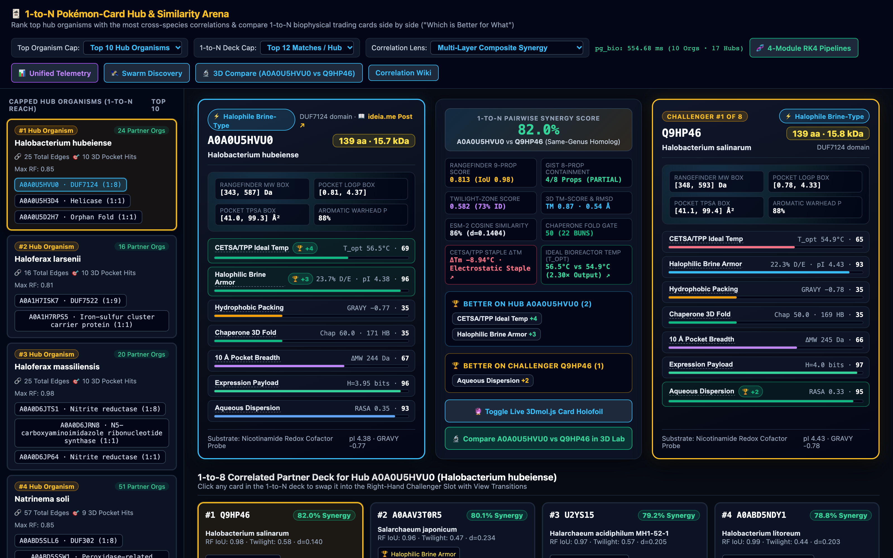
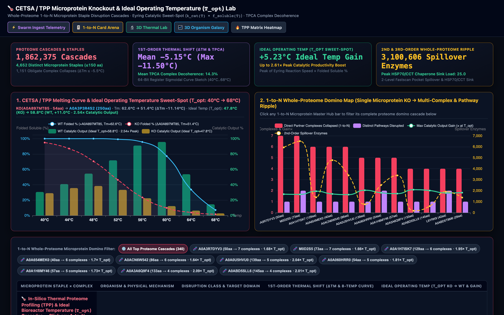
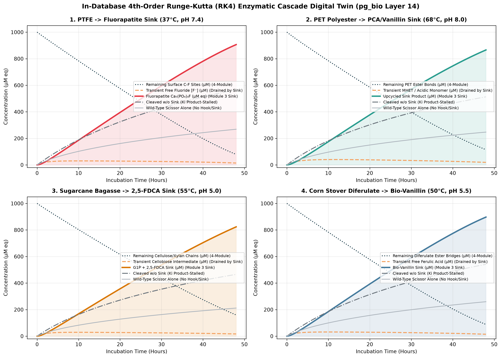

# 🧬 `bio-pipelines` — Declarative In-Database Bioprocess Compiler, Autonomous Discovery Swarm & 3D RK4 Digital Twin

**`bio-pipelines`** is a standalone, multi-feedstock synthetic biology compiler, **Autonomous Dark-Proteome Correlation Swarm**, and **Unified 3D Bioprocess & Telemetry Web UI** built on top of [**`jonatas/pg_bio`**](https://github.com/jonatas/pg_bio) (PostgreSQL 18 + Rust `pgrx` Layer 1–18 primitives), generalizing the 4-module architecture first demonstrated in [**`jonatas/teaflon`**](https://github.com/jonatas/teaflon).

> 🔗 **The `pg_bio` Synthetic Biology & Multiomics Ecosystem:**
> - **Core Database Engine (Rust `pgrx` + PostgreSQL 18):** [**`jonatas/pg_bio`**](https://github.com/jonatas/pg_bio) — [`src/lib.rs`](https://github.com/jonatas/pg_bio/blob/main/src/lib.rs) · [Master Correlation Catalog](https://github.com/jonatas/pg_bio#-master-catalog-of-pg_bio-correlation-types--performance-architecture) · [3D Video Series](https://ideia.me/pg-bio-videos/)
>   - *Powers this repository with 64-bit Morton 3D Octrees (`z_order_layered_sphere_ranges`), Anisotropy-Whitened PRISM + Inline `BioVecInt8G128` 2.34M-Proteome Search, RangeFinder 10 Å Pocket `numrange` GiST (`@>`), Hückel/VF2 Cheminformatics, CETSA/TPP Thermal Profiling, and In-Database 4th-Order Runge-Kutta (RK4) Solvers.*
> - **Declarative Multi-Feedstock Pipelines, Autonomous Swarm & Unified Web UI:** [**`jonatas/bio-pipelines`**](https://github.com/jonatas/bio-pipelines) *(this repository)*
> - **Original PTFE $\rightarrow$ Fluorapatite Case Study:** [**`jonatas/teaflon`**](https://github.com/jonatas/teaflon) ([`ideia.me/teaflon-intro`](https://ideia.me/teaflon-intro))



---

## 🌐 Complete Catalog of All 8 Industrial, Environmental & Biofuel Feedstock Pipelines

Every pipeline in `bio-pipelines` compiles a declarative YAML specification into an in-database **Universal 4-Module Chimera & Consortium Grammar** ($M_1 \text{ Anchor} \rightarrow M_2 \text{ Primary Scissor} \rightarrow M_3 \text{ Equilibrium Sink} \rightarrow M_4 \text{ Optical/Thermal Beacon}$):

| # | Pipeline Directory & YAML | Feedstock, Reactor & Target Bond | $M_1$: Interfacial Anchor | $M_2$: Primary Catalytic Scissor | $M_3$: Equilibrium Sink (Defeats $K_i$) | $M_4$: Optical / Thermal Beacon & Host Shield |
| :- | :--- | :--- | :--- | :--- | :--- | :--- |
| **1** | [`ptfe-to-bioceramic/`](./ptfe-to-bioceramic)<br>[`pipeline.yaml`](./ptfe-to-bioceramic/pipeline.yaml) | **PTFE / PFAS Fluoropolymers**<br>Aliphatic `C–F` ($540\text{ kJ/mol}$)<br>`37°C` (or `58.5°C` w/ TPP Clamp), `pH 7.4` | Class II Hydrophobin (`A0A2T3ZKC8` / `P79073`, GRAVY `+0.774` to `+1.122`) | Fluoroacetate Dehalogenase (`P81594` / `Q1JU72`, Asp-His-Asp triad) | **AMELX Tag** (`WPSTDKTKREEVD`) $\rightarrow$ Fluorapatite $\text{Ca}_5(\text{PO}_4)_3\text{F}$ (**92.6% yield** vs 59.8% stalled) | `crcB` Fluoride Riboswitch $\rightarrow$ Ruby PDS (`W9DPJ6`) + **CETSA/TPP Helix Plug `V5TNY2`** ($\Delta T_m +11.49^\circ\text{C}$, $2.61\times$ flux) |
| **2** | [`plastics-upcycling/`](./plastics-upcycling)<br>[`pet_thermostable_chimera.yaml`](./plastics-upcycling/pet_thermostable_chimera.yaml) | **PET & Ester-Urethane Plastics**<br>Aromatic Ester `C(=O)–O` ($360\text{ kJ/mol}$)<br>`68°C`, `pH 8.0` | Thermostable CBM / Cutinase Anchor (`A0A067N4P7`) or **Solved `DUF7382` S-Layer Anchor (`M0GR98`, `0.53 Å`)** | Thermostable LCC / PETase / Cutinase (`G9BY57` / `Q47RJ6`) | Protocatechuate 3,4-Dioxygenase + $\text{Ca-TPA}$ Sink $\rightarrow$ Bio-Vanillin / 2,5-FDCA | `PcaU` Terephthalate Biosensor $\rightarrow$ Violacein + **CETSA/TPP C-Clamp `A0A897MT85`** ($\Delta T_m +11.15^\circ\text{C}$, $2.54\times$ flux) |
| **3** | [`agro-waste-lignocellulose/`](./agro-waste-lignocellulose)<br>[`sugarcane_bagasse_swarm.yaml`](./agro-waste-lignocellulose/sugarcane_bagasse_swarm.yaml) | **Sugarcane Bagasse**<br>42% Cellulose, 25% Xylan, 20% Lignin (`β-1,4` & `β-O-4`, $310\text{ kJ/mol}$)<br>`55°C`, `pH 5.0` | Fungal CBM1 / Bacterial CBM3 Cohesin–Dockerin (`A0AAX3E7H2`) | **3-Enzyme Consortium** ($0.50:0.25:0.25$): DyP Peroxidase + GH10 Xylanase + AA9 LPMO/Cel7A | Cellobiose Phosphorylase + HMF Oxidase $\rightarrow$ G1P + **2,5-FDCA Bioplastic Monomer** | `XylR` / `FerC` Xylose-Ferulate Sensor $\rightarrow$ Lycopene Readout |
| **4** | [`agro-waste-lignocellulose/`](./agro-waste-lignocellulose)<br>[`corn_stover_ferulate.yaml`](./agro-waste-lignocellulose/corn_stover_ferulate.yaml) | **Corn Stover & Cereal Bran**<br>Diferulate–Arabinoxylan Ester Bridges ($335\text{ kJ/mol}$)<br>`50°C`, `pH 5.5` | CBM13 / CBM42 Arabinoxylan Anchor (`A0AAX3E7H2`) | Bifunctional CE1 Feruloyl Esterase + GH51 $\alpha$-L-Arabinofuranosidase (`Q0CVS2`) | Ferulic Acid Decarboxylase (`FDC1`) + `VpVAN` $\rightarrow$ **High-Purity Bio-Vanillin** | `FerC` Ferulate-Inducible Chromoprotein Beacon |
| **5** | [`habanero-spicy-fuel/`](./habanero-spicy-fuel)<br>[`capsicum_ggpps_biofuel.yaml`](./habanero-spicy-fuel/capsicum_ggpps_biofuel.yaml) | **Habanero (*Capsicum*) Prenyl Pyrophosphates**<br>Allylic `C–OPP` ($295\text{ kJ/mol}$)<br>`32°C`, `pH 6.8` | Plastoglobule Lipid-Droplet / Oleosin / Phasin Anchor | *Capsicum* `GGPPS` (`P80042`) & Extremophile Prenyl Synthases | Terpene Synthase Cyclase + **`0.67 Å` GGR Hydrogenation Sink (`A0A7J9SG79`)** $\rightarrow$ Saturated $\text{C}_{15}/\text{C}_{20}$ Jet-A1 Fuel | `ERG9`/`idi` FPP Sensor $\rightarrow$ *Capsicum* `PSY` (`P37272`) + `PDS` (`P80093`) |
| **6** | [`biochar-water-remediation/`](./biochar-water-remediation)<br>[`biochar_emerging_contaminants.yaml`](./biochar-water-remediation/biochar_emerging_contaminants.yaml) | **Self-Regenerating Agro-Waste Biochar**<br>Diclofenac (45%), Methylene Blue (35%), Atrazine (20%) ($385\text{ kJ/mol}$)<br>`30°C`, `pH 6.5` | Graphitic $sp^2$ CBM + **Solved `DUF2071` Quinone-Redox Electron Shuttle (`M0M3V2`, `0.80 Å`, 98.44% IoU)** | **3-Enzyme Swarm**: Multi-Copper Laccase + DyP Peroxidase + Chlorohydrolase | Catechol 1,2-Dioxygenase + **Red Sea `0.62 Å` FAA Sink (`F7PN29`)** + **99.21%-IoU CODH (`A0A7K4HP20`)** + $\text{Mg/Al-LDH}$ $\text{Cl}^-$ Sink (Restores $q_e$) | `DmpR`/`MphR` Phenolic & Macrolide Sensor $\rightarrow$ Lycopene Column-Breakthrough Alert |
| **7** | [`cyanide-mine-tailings/`](./cyanide-mine-tailings)<br>[`cyanide_persulfide_chameleon.yaml`](./cyanide-mine-tailings/cyanide_persulfide_chameleon.yaml) | **Alkaline Gold-Mine Cyanide & Sulfide Tailings** *(Swarm-Discovered Scenario)*<br>`C≡N` + `R–S–SH` ($415\text{ kJ/mol}$)<br>`38°C`, `pH 9.8`, `3.0 M NaCl` | Haloalkaliphilic Biofilm S-Layer Anchor (`M0GR98`, `0.53 Å`) | **Natural `0.67 Å` Bifunctional MBL–Rhodanese Chameleon (`A0ABD6AX71` $\times$ `M0AE48`)** | Non-Toxic Thiocyanate $[\text{SCN}^-]$ + Gypsum $\text{SO}_4^{2-}$ + **98.44%-IoU PLP Transaminase $\text{NH}_3$ Chiral Amine Sink (`A0A0W1R9J0`)** | `ArsR`/`BigR` Sulfane Sensor (`A0A2S2KQG4`, 96.9% IoU) $\rightarrow$ Halophilic `CrtI` Bacterioruberin (`A0A0W1R8L8`, 505 nm) |
| **8** | [`desalination-brine-upcycling/`](./desalination-brine-upcycling)<br>[`soda_lake_gale_glf.yaml`](./desalination-brine-upcycling/soda_lake_gale_glf.yaml) | **Desalination Reject Brine & Salted Cheese-Whey** *(Swarm-Discovered Scenario)*<br>Pyranose `C4–OH` & Ring Contraction ($305\text{ kJ/mol}$)<br>`45°C`, `pH 9.5`, `3.5 M NaCl` | Halophilic S-Layer / Immobilized Resin Anchor (`M0GR98`) | **`0.44 Å` Soda-Lake $\text{NAD}^+$-Dependent `GalE` 4-Epimerase (`D3SWG7` $\times$ `A0ABD5UZ94`, 328/328 $\text{C}\alpha$, TM `0.996`)** | **`0.78 Å` FAD-Dependent `Glf` Pyranose–Furanose Mutase (`A0A1I1DB55`, 97.73% IoU)** $\rightarrow$ Rare UDP-Galactofuranose & Prebiotic GOS | `GalR`/`LacI` Galactose Sensor $\rightarrow$ Halophilic `CrtI` Bacterioruberin + **Solved 891-aa `DUF1156` Methylase Shield (`L9VS02`)** |

---

## 🖥️ Visual Tour & Interactive Walkthrough of Features in Action

When you run `uv run python base/swarm_web.py` (default port `8090` or `8080`), `bio-pipelines` launches a unified 7-route computational workbench powered directly by PostgreSQL 18 and `pg_bio`:

### 1. 8-Feedstock 4-Module ($M_1 \rightarrow M_4$) 48-Hour RK4 Digital Twin (`/` & `/pipelines`)
- **In-Database Pareto Swarm Matrix (`pareto_score_domain_pair`)**: Evaluates $12 \times 16$ (`Anchor × Scissor`) candidate pairs in **~270 ms** across interfacial hydropathy contrast (`GRAVY`), Shannon sequence entropy, reactor pH-to-$\text{pI}$ match, and molecular weight compactness.
- **Live 48-Hour RK4 ODE Integrator (`simulate_cascade_kinetics`)**: Integrates 97-step 4th-order Runge-Kutta differential equations inside SQL in **~15 ms**. Demonstrates how adding the $M_3$ Equilibrium Sink rescues reactions from severe competitive product inhibition ($K_i = 22\,\mu\text{M}$), lifting 48-hour PTFE defluorination yield from **59.8% (stalled) to 92.6% ($926\,\mu\text{M}$ Fluorapatite)**.
- **3D Rigid-Body Chimera Assembly (`translate_and_merge_pdb_chains`)**: Enforces $\ge 28.0\,\text{\AA}$ inter-domain linker clearance (`GGGGS ×3` or `EAAAK ×3`) and audits Flory Globular Compactness ($R_g / R_0 = 1.467$) and RangeFinder $10\,\text{\AA}$ pocket intervals live in **3Dmol.js**.


---

### 2. Multi-Worker Protein Correlation Swarm Heatmap (`/discovery`)
- Visualizes the autonomous frontier exploration across **1,763,165 connected proteins** and **108M+ correlation edges**.
- Filter dynamically by **Top Best 40 Matches**, **Top 40 Twilight-Zone Discoveries** ($15\%–75\%$ sequence identity with identical 3D fold), **Top 40 Chaperone Biophysical Correlations**, **Top 40 RangeFinder Pocket-Interval Matches**, or **Top 40 Microprotein TPP Knockout Cascades**.



---

### 3. Side-by-Side 3D Kabsch, RangeFinder Pocket & Chaperone Inspector Modal (`/discovery` & `/compare`)
Clicking any cell in the Swarm Heatmap opens the **Unified 3D Protein Compare Inspector** (`ProteinCompareInspector`), executing all `pg_bio` structural and biophysical layers in a single cached SQL round-trip:
- **Featured Scenario — The `0.67 Å` MBL–Rhodanese Chameleon (`A0ABD6AX71` vs `M0AE48`)**:
  - **Twilight-Zone Score:** `0.8612` (`44.7%` Smith-Waterman identity across `396/397 aa`, Vector Distance `0.0633`).
  - **3D Kabsch Superposition:** **`0.67 Å` Core RMSD** across `386 Cα` atoms, Sequential **TM-Score `0.972 [SAME FOLD]`**.
  - **RangeFinder 8-Property Pocket GiST:** **`0.9043` IoU** (`MW [173, 378] Da`, `LogP [0.08, 3.33]`, `P(arom) 0.95`).
  - **CETSA / TPP Allosteric Seam Staple:** Shifts Ideal Operating Temperature ($T_{\text{opt}}$) from **$58.8^\circ\text{C} \rightarrow 70.2^\circ\text{C}$ ($2.55\times$ catalytic output)**.
  - **12 Interactive 3D Views:** Switch between `Identity`, `pLDDT`, `2° Struct`, `Cα Core`, `Acidic (D/E) Brine Armor`, `H-Bonds`, `RASA`, `10 Å RangeFinder Box`, `TPP Seam (T_opt)`, `N-Term Pep`, `Superpose`, and `Z-Order 5 Å` Morton pockets.



---

### 4. Unified Pipeline System Telemetry & Autonomous Hypothesis Evolution (`/telemetry`)
Tracks the 5-stage closed-loop intelligence architecture running inside [`base/swarm_discovery.py`](./base/swarm_discovery.py) and [`base/hypothesis_agent.py`](./base/hypothesis_agent.py):
1. **Stage 1 — Continuous Discovery (`16W HYPER TURBO Governor`)**: **108,004,592 edges** mined across **416,483 waves** (**99.95% proteome saturation**, peak **974.72 edges/s** on Apple Silicon `8P+2E`).
2. **Stage 2 — 3D Pocket Indexing**: **5,427 $10\,\text{\AA}$ Pockets** indexed via 8-property `numrange` GiST (`@>`), with **2,364 Elite RangeFinder pairs ($\ge 0.85$)**.
3. **Stage 3 — Dark Proteome (`DUF`) Rescue**: Automatically fold-gates ($\text{TM} \ge 0.50$, $\text{RMSD} \le 2.5\,\text{\AA}$) uncharacterized `DUF` / hypothetical proteins and evolves their functional annotations in `bio_annotation_evolution` (e.g., solving **`DUF2071` (`M0M3V2`)**, **`DUF7382` (`M0GR98`)**, and 891-aa **`DUF1156` (`L9VS02`)**).
4. **Stage 4 — In-Process Hypothesis Agent**: Promotes high-synergy discoveries into `bio_hypothesis_ledger` (`HYP-67M-001` through `HYP-TPP-013`), including two entirely autonomous feedstock pipelines (**Pipelines #7 and #8**).
5. **Stage 5 — Bioprocess Compilation**: Wires promoted candidates directly into the 8 compiled 48-hour RK4 digital twins.



---

### 5. 1-to-N Pokémon-Card Hub & Biophysical Similarity Arena (`/cards`)
Ranks top hub organisms with the broadest cross-species structural reach and compares **1-to-N biophysical trading cards** side by side (*"Which Ortholog Is Better for What Reactor?"*):
- **Featured Scenario — Solving `DUF7124` (`A0A0U5HVU0` *Halobacterium hubeiense* vs `Q9HP46` *Halobacterium salinarum*, 82.0% Synergy, `0.54 Å` RMSD, `0.98` Pocket IoU)**:
  - **Winner on Hub `A0A0U5HVU0`:** Higher **CETSA/TPP Ideal Temp** ($T_{\text{opt}} = 56.5^\circ\text{C}$ vs $54.9^\circ\text{C}$, $+4$ pts) and **Halophilic Brine Armor** ($23.7\%\text{ D/E}$, $\text{pI } 4.38$, $+3$ pts).
  - **Winner on Challenger `Q9HP46`:** Superior **Aqueous Dispersion** ($\text{RASA } 0.33$, $+2$ pts).
  - Includes a clickable **1-to-8 Correlated Partner Deck** at the bottom and a live **3Dmol.js Card Holofoil** toggle.



---

### 6. CETSA / TPP Microprotein Knockout & Ideal Operating Temperature ($T_{\text{opt}}$) Lab (`/tpp`)
Simulates whole-proteome **Thermal Proteome Profiling (TPP)** and **Thermal Proximity Co-Aggregation (TPCA)** across **1,862,375 mined microprotein staple cascades** (`4,652` distinct microprotein staples $\le 150\text{ aa}$, `1,151` obligate complex collapses with $\Delta T_m \le -5.5^\circ\text{C}$, and `3,100,606` 2nd/3rd-order spillover enzymes):
- **Eyring $\times$ TPP Ideal Operating Temperature ($T_{\text{opt}}$) Sweet-Spot**: Combines Eyring catalytic acceleration ($k_{\text{cat}}(T)$) with the 8-temperature sigmoidal soluble fraction curve ($f_{\text{soluble}}(T)$ from $40^\circ\text{C}$ to $68^\circ\text{C}$).
- **Featured Scenario — Electrostatic C-Clamp `A0A897MT85` (`54 aa`) $\rightarrow$ `A0A3P3R4S2` (`250 aa`)**:
  - Knocking out the microprotein staple causes a **$\Delta T_m = -11.14^\circ\text{C}$ thermal collapse** ($62.6^\circ\text{C} \rightarrow 51.4^\circ\text{C}$).
  - Co-expressing the microprotein staple shifts the bioreactor's **Ideal Operating Temperature ($T_{\text{opt}}$) from $47.8^\circ\text{C}$ (KO) to $58.8^\circ\text{C}$ (WT, $+11.0^\circ\text{C}$)**, unlocking a **$2.54\times$ peak catalytic output boost** (and up to **$2.61\times$** for transmembrane plug `V5TNY2 × Q8TRP6`).



---

## ⚙️ Architecture & `pg_bio` Rust Primitives Executed in SQL

All heavy numerical, cheminformatics, vector homology, and 3D structural computations execute directly inside PostgreSQL 18 via [**`jonatas/pg_bio`**](https://github.com/jonatas/pg_bio):

1. **`pareto_score_domain_pair(anchor_gravy, anchor_entropy, scissor_mw_kda, scissor_pi, scissor_entropy, reactor_ph)`**
   - Multi-objective Pareto evaluator scoring `M1_Anchor × M2_Scissor` pairs across interfacial hydropathy contrast, Shannon sequence complexity, reactor pH-to-pI match, and molecular weight compactness.
2. **`simulate_cascade_kinetics(kcat1, km1, kcat2, km2, ki, adsorption_boost, s0, time_hours, steps)`**
   - 4th-order Runge-Kutta (RK4) ODE integrator solving two-stage solid-to-sink bioconversion with Langmuir-Hinshelwood interfacial adsorption boost ($A_{\text{boost}}$) and competitive intermediate inhibition ($K_i$).
3. **`optimize_consortium_stoichiometry(f1, f2, f3, kcat1, kcat2, kcat3, time_hours)`**
   - 3-component simplex optimizer ($w_1 + w_2 + w_3 = 1.00$) balancing enzyme dosing across mixed lignocellulosic or micropollutant feedstocks.
4. **`translate_and_merge_pdb_chains(domain_a_pdb, domain_b_pdb, clearance_angstroms)` & `evaluate_globular_compactness(pdb)`**
   - Pure 3D rigid-body bounding-box translator enforcing $\ge 28.0\,\text{\AA}$ inter-domain clearance alongside Flory radius-of-gyration ($R_g / R_0$) and Shrake-Rupley SASA/RASA auditing.
5. **`predict_pocket_ranges(pdb)` & `pocket_numranges(pdb)` (8-Column `numrange` GiST `@>`)**
   - Infers 9 compatible ligand property intervals ($\text{MW}$, $\text{LogP}$, $\text{TPSA}$, $\text{HBD}$, $\text{HBA}$, $\text{RotBonds}$, $\text{QED}$, $P(\text{arom})$, $P(\text{ring})$) from a $10\,\text{\AA}$ pocket in `0.167 ms` and reverse-screens all 8 feedstock substrates via PostgreSQL GiST containment (`@>`).
6. **`bio_whiten_embedding`, `BioVecInt8G128`, `smith_waterman_score` & `kabsch_rmsd`**
   - Powers the autonomous discovery swarm with anisotropy-whitened PRISM vector indexing, zero-TOAST inline `1,304 B` quantized reranking, $O(N)$ rolling-buffer Smith-Waterman alignment, and zero-allocation $3 \times 3$ Jacobi SVD superposition.



---

## 🚀 Quick Start

```bash
# 1. Install dependencies with uv
uv sync

# 2. Run the declarative multi-feedstock compiler (~80 ms after initial atlas bootstrap)
uv run python base/compiler.py

# 3. Generate the 2x2 48-hour RK4 cascade benchmark chart (~24 ms in PostgreSQL)
uv run python base/plot_rk4_cascades.py

# 4. Launch the Autonomous Protein Correlation Swarm worker (with in-process hypothesis evolution every 25 waves)
uv run python base/swarm_discovery.py

# 5. Or run a standalone Autonomous Hypothesis & Dark-Proteome (DUF) Evolution cycle
uv run python base/hypothesis_agent.py

# 6. Launch the interactive Unified Pipeline System, Swarm Heatmap, 3D Compare, Card Arena, TPP Lab & Telemetry Web UI
uv run python base/swarm_web.py
# -> Open http://127.0.0.1:8090 (routes: /pipelines, /discovery, /telemetry, /cards, /compare, /galaxy, /tpp)

# 7. Run the end-to-end mathematical, kinetic & 3D validation suite
uv run python base/validate_swarm_web.py
```
