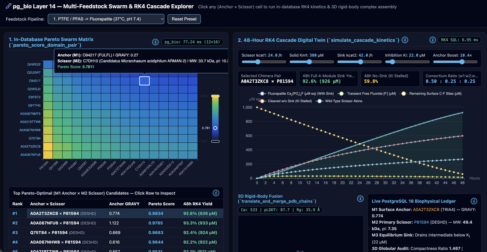
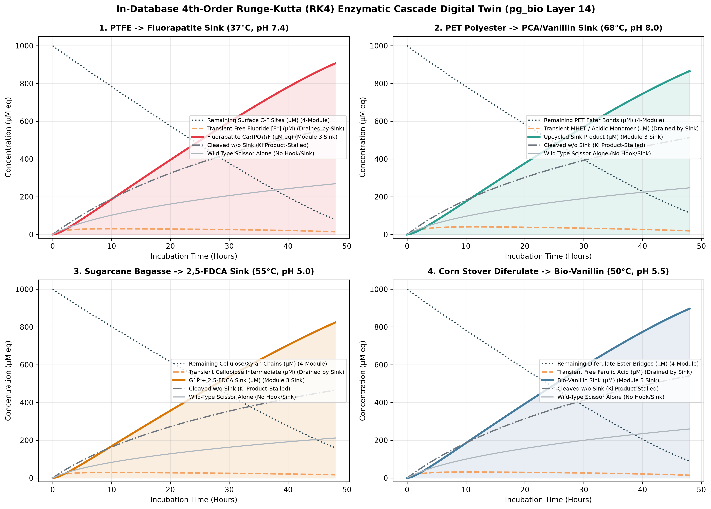

# 🧬 `bio-pipelines` — Declarative In-Database Bioprocess Compiler & RK4 Cascade Explorer

`bio-pipelines` is a standalone, multi-feedstock synthetic biology and industrial bioprocess compiler built on top of [**`pg_bio`**](https://github.com/jonatas/pg_bio) (PostgreSQL 18 + Rust Layer 1–14 primitives), generalizing the 4-module architecture first demonstrated in [**`teaflon`**](https://github.com/jonatas/teaflon).

> 🔗 **Ecosystem Links:**
> - **Core Database Engine (Rust + PostgreSQL 18):** [`jonatas/pg_bio`](https://github.com/jonatas/pg_bio) ([`src/lib.rs`](https://github.com/jonatas/pg_bio/blob/main/src/lib.rs))
> - **Original PTFE $\rightarrow$ Fluorapatite Case Study:** [`jonatas/teaflon`](https://github.com/jonatas/teaflon) ([`ideia.me/teaflon-intro`](https://ideia.me/teaflon-intro))
> - **Declarative Multi-Feedstock Pipelines & RK4 Swarm UI:** [`jonatas/bio-pipelines`](https://github.com/jonatas/bio-pipelines) *(this repository)*



It implements the **Universal 4-Module Chimera & Consortium Grammar** across four recalcitrant solid-phase feedstocks:

| Pipeline Directory | Feedstock & Target Bond | Module 1: Interfacial Anchor | Module 2: Primary Scissor | Module 3: Equilibrium Sink | Module 4: Optical Beacon |
| :--- | :--- | :--- | :--- | :--- | :--- |
| [`ptfe-to-bioceramic/`](./ptfe-to-bioceramic) | **PTFE / PFAS** (`C-F`, 540 kJ/mol, 37°C, pH 7.4) | Class II Hydrophobin (`P79073` / `A0A2T3ZKC8`) | Fluoroacetate Dehalogenase (`Q1JU72` / `P81594`) | AMELX Tag $\rightarrow$ Fluorapatite $\text{Ca}_5(\text{PO}_4)_3\text{F}$ | `crcB` Fluoride Riboswitch $\rightarrow$ Phytoene Desaturase |
| [`plastics-upcycling/`](./plastics-upcycling) | **PET & Polyurethane** (`C(=O)-O`, 360 kJ/mol, 68°C, pH 8.0) | CBM / Cutinase Anchor (`A0A067N4P7`) | Thermostable LCC / PETase / Cutinase (`G9BY57` / `Q47RJ6`) | Protocatechuate Dioxygenase $\rightarrow$ Vanillin / 2,5-FDCA | `PcaU` Terephthalate Biosensor |
| [`agro-waste-lignocellulose/`](./agro-waste-lignocellulose) | **Sugarcane Bagasse** (42% Cellulose, 25% Xylan, 20% Lignin, 55°C, pH 5.0) | Fungal CBM1 / Bacterial CBM3 Dockerin (`A0AAX3E7H2`) | 3-Enzyme Swarm (DyP Peroxidase + GH10 Xylanase + AA9 LPMO/Cel7A) | Cellobiose Phosphorylase + HMF Oxidase $\rightarrow$ 2,5-FDCA | `XylR` / `FerC` Biosensor $\rightarrow$ Lycopene |
| [`agro-waste-lignocellulose/`](./agro-waste-lignocellulose) | **Corn Stover & Bran** (Arabinoxylan–Diferulate Bridges, 50°C, pH 5.5) | CBM13 / CBM42 Arabinoxylan Anchor (`A0AAX3E7H2`) | CE1 Feruloyl Esterase + GH51 Arabinofuranosidase (`Q0CVS2`) | Ferulic Acid Decarboxylase (`FDC1`) + `VpVAN` $\rightarrow$ Bio-Vanillin | `FerC` Ferulate-Inducible Beacon |

---

## Architecture & `pg_bio` Layer 14 Rust Primitives

All heavy numerical, cheminformatics, and 3D structural computations execute directly inside PostgreSQL 18 via `pg_bio`:

1. **`pareto_score_domain_pair(anchor_gravy, anchor_entropy, scissor_mw_kda, scissor_pi, scissor_entropy, reactor_ph)`**
   - Multi-objective Pareto evaluator scoring `M1_Anchor × M2_Scissor` pairs across interfacial hydropathy contrast, Shannon sequence complexity, reactor pH-to-pI match, and molecular weight compactness.
2. **`simulate_cascade_kinetics(kcat1, km1, kcat2, km2, ki, adsorption_boost, s0, time_hours, steps)`**
   - 4th-order Runge-Kutta (RK4) ODE integrator solving two-stage solid-to-sink bioconversion with Langmuir-Hinshelwood interfacial adsorption boost ($A_{\text{boost}}$) and competitive intermediate inhibition ($K_i$).
3. **`optimize_consortium_stoichiometry(f1, f2, f3, kcat1, kcat2, kcat3, time_hours)`**
   - 3-component simplex optimizer ($w_1 + w_2 + w_3 = 1.00$) balancing enzyme dosing across mixed lignocellulosic feedstocks.
4. **`translate_and_merge_pdb_chains(domain_a_pdb, domain_b_pdb, clearance_angstroms)`**
   - Pure 3D rigid-body bounding-box translator enforcing $\ge 28.0\,\text{\AA}$ inter-domain clearance alongside `evaluate_globular_compactness()`.



---

## Quick Start

```bash
# 1. Install dependencies with uv
uv sync

# 2. Run the declarative 4-feedstock compiler (~80 ms after initial atlas bootstrap)
uv run python base/compiler.py

# 3. Generate the 2x2 48-hour RK4 cascade benchmark chart (~24 ms in PostgreSQL)
uv run python base/plot_rk4_cascades.py

# 4. Launch the interactive Multi-Feedstock Swarm & RK4 Cascade Explorer web UI
uv run python base/swarm_web.py
# -> Open http://127.0.0.1:8090

# 5. Run the end-to-end mathematical, kinetic & 3D validation suite
uv run python base/validate_swarm_web.py
```
